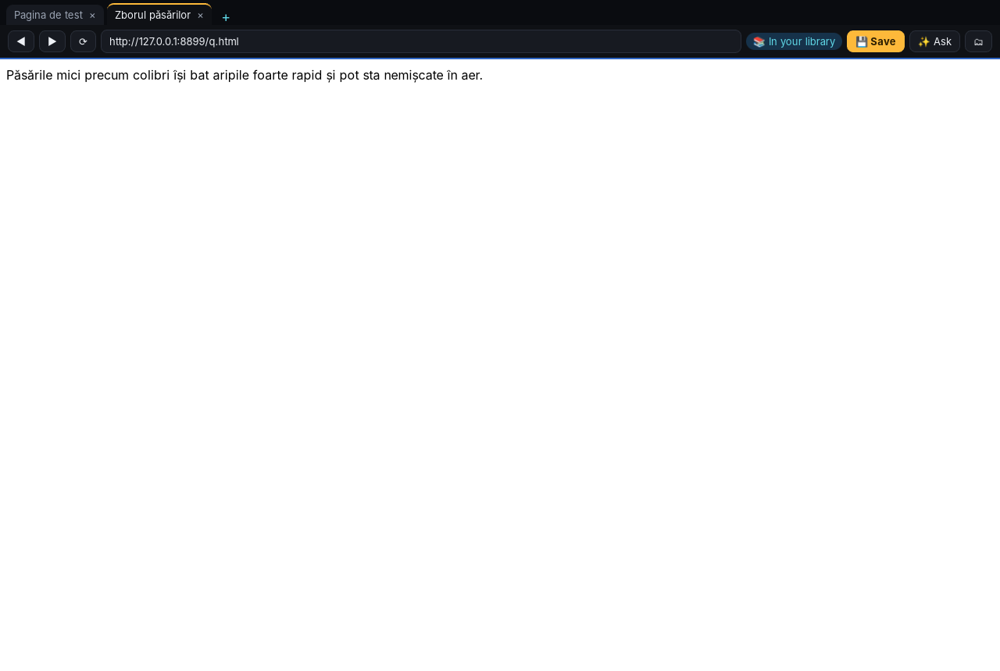

# web-grab

Bring web pages into your CartaColibri library — 100 % local; the address is kept as the source so
RAG-CARTA citations lead back to the page.

| Way | How | Tested |
|---|---|---|
| **Browser** `cartacolibri-browser [URL…]` | A small Rust browser on the system webview (WebKitGTK / WebView2 / WKWebView), with **tabs** (Ctrl+T / Ctrl+W / Ctrl+Tab / Ctrl+L, session restored; `--fresh` to skip). Replaces the Falkon plugin idea: no Falkon code, MIT. See below. | Linux: CI self-tests under Xvfb (save, ask, two tabs asked together). Windows / macOS: compiled in CI, **not yet run by hand** |
| Command line | `cartacolibri grab https://example.org/article` | CI |
| Bookmarklet (any other browser) | `cartacolibri bookmarklet` prints a `javascript:` link; save it as a bookmark and click it on a page (a selection is saved instead of the whole page) | the `/carta/clip` endpoint is tested; a page's CSP can block it |
| API | `POST /carta/grab`, `POST /carta/clip?token=…` | CI |

What makes it different from other browsers — it is wired to your library, all locally
- 📚 **Already in your library** badge, and a ⚠ when the live page **differs from the saved copy** (saving again refreshes that same file, never a duplicate).
- 🔗 **Related in your library** while you browse (RAG-fetch on the page title); click the badge to see the hits.
- 💾 Save the page or just your selection; the address is kept as the source.
- ✨ **Ask** your local Colibrì about the page, with a `[S1]` citation; **🗂 ✨ ask all open tabs** (Ctrl+Enter in the question box) saves them and answers across them with `[S1]`, `[S2]`… per tab.
- 🖍 **Highlight** the selection: it is stored in the saved page (`## Highlights`, searchable) and re-marked on every visit; it survives refreshes of the saved copy.
- 👁 **Watch** a page: `cartacolibri webwatch add|list|rm|check [--refresh]|run --minutes N` fetches it again and shows a `+`/`-` diff of what changed; `--refresh` updates the saved copy.
- 🖼 Every save keeps an **HTML snapshot** (≤ 3 MB) next to the library; the badge panel shows its path and, when the page changed, the diff.
- 🕘 **Searchable history** (off by default, local only): `cartacolibri history on|off|clear|status` or the 🕘 button.
- 🗂 ✨ / 📝 / 📊 **ask, summarize or extract across all tabs** (for extract, type the fields separated by commas).
- Type `?your question` in the address bar to **ask your whole library** (top 8 hits, cited `[S#]`).
- 🗂 **Save all tabs as a library group** (`tabs-<time>`), ready for summarize / extract / synthesize in the app.
- The address bar takes **words** too: they search your library instead of the web.
- Bar in 8 languages (follows the browser language).

Browser notes
- The bar is injected into every page inside a closed shadow root; its messages to the app carry a random per-run
  nonce, so page scripts cannot trigger saves or questions.
- Links that ask for a new window open in a new tab. No extensions, no sync, no telemetry. The text of each loaded page is read by the bar and handed to the local app only (it feeds the badge, the related list and the tab-wide questions).
- Windows / macOS tabs use child webviews with manual resizing — written but not yet run by hand.
- Build: `cargo build --release -p cartacolibri-browser` (Linux needs `libwebkit2gtk-4.1-dev`; Windows needs the WebView2 runtime).
- Pages are decoded as the site declares; a page without a charset can show wrong accents.
